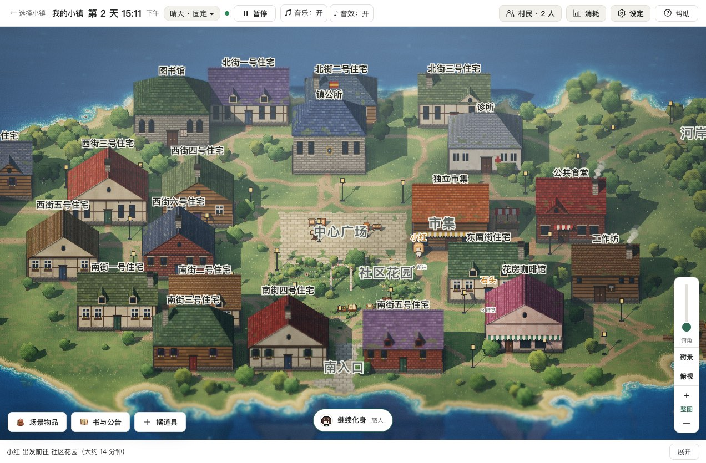
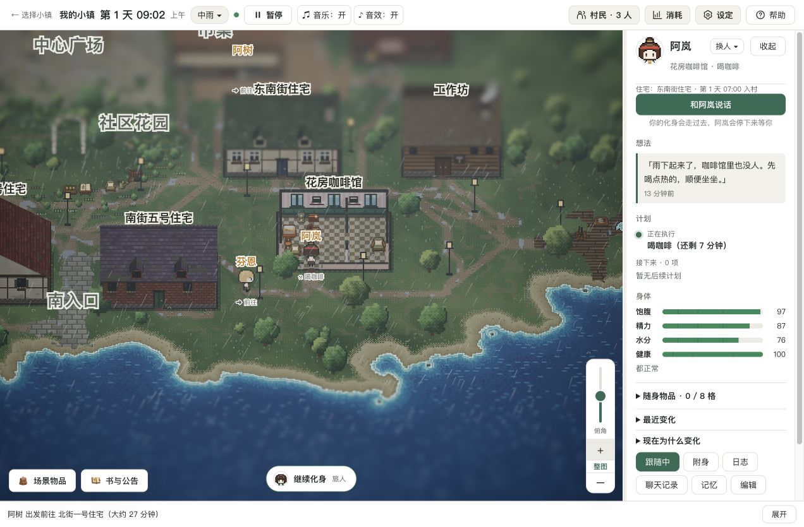
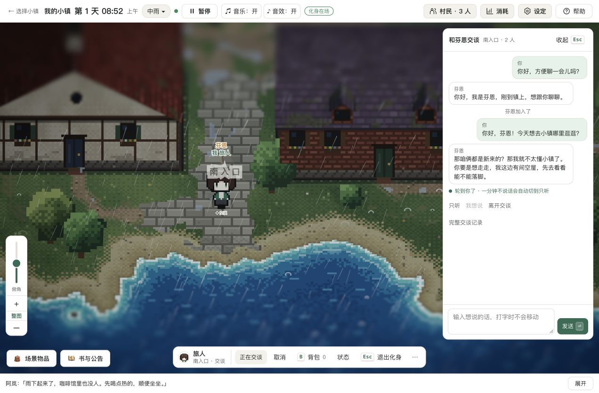

# AI 小镇

一个由 AI 居民自己过日子的小镇。你可以站在旁边看，也可以造一个化身走进去，和他们说话、做事、一起走一段路。

居民会安排一天的活、使用手边的道具、结识邻居，并记住亲身经历过的每件事。**模型负责提议**——想做什么、说什么；**世界内核负责裁决**——能不能做、做了什么、留下什么。所以发生了什么，以世界里的实际结果为准，不是以模型说了什么为准。



> **这个仓库是二次开发版本。** 源自 [mewamew/my_ai_town](https://github.com/mewamew/my_ai_town) 在 `b6e513d` 的快照，历史从这里重新起步，不含上游的提交链。署名、许可与素材范围一并不变，见 [NOTICE](NOTICE)。
>
> **Windows 尚未实机测试。** 应用壳和交叉编译脚本都在，但启动、WebView2、内置模型、存档和中文路径仍待实机验证。

## 能做什么

- **看得见的居民生活。** 点开一位居民，能看到他正在做的事、这一轮的想法、身体状态、日记、聊过的话和记住的事。
- **走进小镇。** 造一个化身，和居民交谈、结伴同行、递东西、写书贴公告；也可以直接附身接管一名居民。
- **自己造镇。** 从村民库邀请居民、改人设和长相、编辑地图、在地图上摆道具；也可以让在线模型帮你写小镇描述和人设。
- **三种开局玩法。** 选择小镇页里有「大逃杀荒岛」（潮水四天收五圈，只活一个）、「月影村狼人杀」（6～12 人，法官主持白天发言投票、夜里各身份行动）、「三体 · 执剑人之夜」（威慑纪元 62 年选新执剑人的一天）。旁观时画面会画出潮水圈、座位票型，或名单、演说与倒计时。
- **两种模型来源。** 在线模型（任何 OpenAI 兼容的 `/chat/completions` 服务）或内置的本地小模型；后者专为村民日常决策训练，不必配 API 密钥。





## 快速开始

需要 Node.js ≥ 22.18（见 `.nvmrc`）、Corepack 和 Rust 1.88.0。

```sh
git clone https://github.com/NJHHBJSJKAsjdsasa/aixiaozheng.git
cd aixiaozheng
corepack pnpm install --frozen-lockfile
cargo +1.88.0 build --locked -p host -p manager --bins
corepack pnpm build
corepack pnpm preview
```

打开 `http://127.0.0.1:5174`。第一次进镇有向导：选模型、邀请居民、填世界观，然后点开始。

改了 Rust 代码要重新 `cargo build` 再重启；改前端源码后用 `corepack pnpm dev` 热更新。开发模式、平台打包、内置模型编译和检查命令都在[开发入口](docs/README.md)。

**要本地模型**（Apple 芯片）：先装 CMake 与 Xcode 命令行工具，跑 `node scripts/builtin-model/build.mjs` 编译推理程序，重启服务后在「设定 → 内置模型」下载约 529 MB 的权重。只用在线模型的话跳过这一步。

## 代码结构

| 目录 | 内容 |
| --- | --- |
| `crates/kernel` | 世界内核：人物、场所、道具、需求、动作校验与结算、玩法规则 |
| `crates/agent` | 居民 Agent：题面、工具、上下文折叠、记忆与笔记 |
| `crates/host` | 世界进程：推进、模型传输、存档、录像、WebSocket |
| `crates/manager` | 管理服务：小镇列表、建镇校验、按需拉起世界进程 |
| `crates/protocol` | 服务与页面之间的消息类型（`ClientMsg` / `ServerMsg`） |
| `frontend/town-2d` | HD-2D 画面：像素角色、立体场景、昼夜天气、玩法界面 |
| `frontend/town-shared` | 前端共用：素材、音乐、协议类型、预制小镇 |
| `scripts/` | 启动、建镇生成器、打包、录像与拍素材 |
| `android/` `macos/` `windows/` | 三个应用壳，都启动同一个 Rust 管理服务、共用同一套前端 |
| `data/` | 内置地图、生成模板、公共道具定义 |
| `config/` | 应用配置与村民库 |

## 本仓库加的两件自动化

模型每做一次决定就是一次完整请求。下面两处把「答案唯一」的事从模型手里拿走，交回内核，减少无谓请求，同时不改动玩法规则。

**生存自动机**（`crates/kernel/src/survival.rs`）。饿、渴、累到紧急线、又站着没事做的居民，由内核按「路程 + 动作时长」最短挑一处道具和处所，直接排好一组动作；这一轮的想法取需求自己那句话（「很饿，先吃干粮。」）。正在做事、在交谈、被玩家接管的居民一律不打扰；排出来的动作和模型动作走同一条 `run_actions`——校验、记账、录像都不另开旁路。默认开启，`AI_TOWN_SURVIVAL=off` 关掉后完全回到模型决策。

**日程**（`crates/kernel/src/schedule.rs`）。模型可以用 `plan` 工具一次排好几件带时刻的事（每人最多 4 件），到点由内核直接执行；这中间不再为「现在该干嘛」发请求。有人叫住、被推开、身体告急，整份日程作废，交回模型重排；到点还忙着就先留着，迟到超过 90 分钟作废。观察里写着还剩几件、下一件多久后做什么，居民自己知道日程排到哪了。

想要纯粹由模型决定一切，设上 `AI_TOWN_SURVIVAL=off`、并且不让居民用 `plan` 即可——两处都是可选行为，不是规则。

## 平台状态

| 平台 | 情况 |
| --- | --- |
| macOS / 浏览器 | 已在 Apple 芯片的 Mac 上完成源码编译、Chrome 启动与核心流程检查 |
| macOS 应用 | Swift 应用壳 + DMG 打包脚本，macOS 13+ / Apple 芯片；仓库不附带已签名公证的 DMG |
| Android | 应用壳 + APK 打包脚本，Android 8.0+ / arm64；内置模型要求 armv8.2-a、dotprod、fp16 |
| **Windows** | **尚未实机测试。** 目标是 Windows 10/11 x64 + WebView2，内置模型要求 AVX2；按实验性支持看待 |
| Linux | 未验证；CI 通过不等于各平台都能跑 |

## 数据与隐私

- 存档在用户目录：macOS `~/Library/Application Support/MyAiTown`，Windows `%LOCALAPPDATA%\MyAiTown`。可用 `AI_TOWN_HOME` 指到别处（测试和备份建议这么做）。
- 小镇地图、道具、居民、记忆和日志都在本机，不写回仓库。旧 Godot 存档不会被自动读取、转换或删除。
- 模型不可用时，相关决策暂停，不用脚本代替——不假装居民还在自己活着。
- API 密钥只存在本机 `config/credentials.json`。用在线模型时，相应请求里的人设、对话、记忆和世界上下文会发给配置的服务商；公开提问前请先脱敏。

## 授权与参与

项目原创代码与文档采用 **[PolyForm Noncommercial 1.0.0](LICENSE)**：源码公开，仅限许可条款定义的非商业用途；商业使用需另行取得授权。许可还明确允许其中列举的教育、公益、公共研究、政府等机构使用，具体以英文全文为准。

第三方依赖、Kenney 音效、llama.cpp 和下载的模型沿用各自许可，既有权利不受本项目限制。音乐、美术与图标由维护者确认自有或已获授权，可随项目分发，但不额外授权单独打包或用于其他项目；范围见 [NOTICE](NOTICE) 与[素材说明](licenses/ASSETS.txt)。

问题与建议请提到 [Issues](https://github.com/NJHHBJSJKAsjdsasa/aixiaozheng/issues)，附上系统、启动方式、复现步骤和脱敏后的报错；Windows 请注明系统版本与 WebView2 情况。改代码前先读 [AGENTS.md](AGENTS.md)，提交前跑[检查命令](docs/README.md#检查)。
